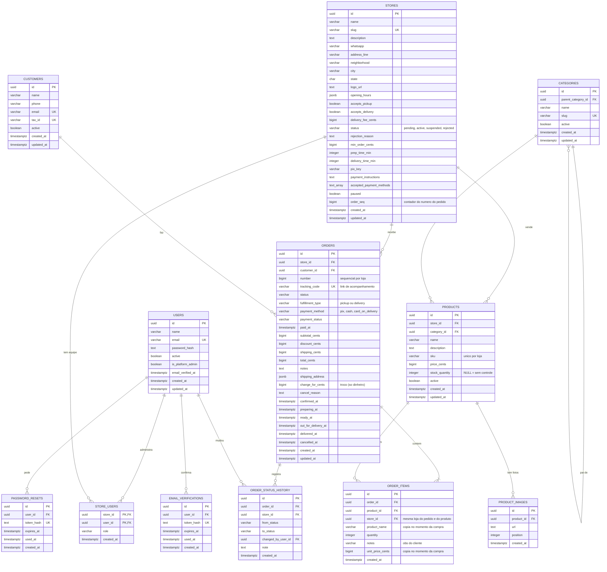

# Banco de dados — modelo do MVP (multi-loja)

Documento com o desenho das tabelas e das ligações do banco. O modelo cobre
usuários e lojas (`users`, `stores`, `store_users`), catálogo (`categories`,
`products`, `product_images`), clientes (`customers`) e vendas (`orders`,
`order_items`), além de redefinição de senha, confirmação de e-mail e
histórico de situação do pedido (`password_resets`, `email_verifications`,
`order_status_history`).

Os nomes de tabelas e colunas seguem o padrão **inglês + `snake_case`**. A
prosa e os comentários continuam em português.

A fonte da verdade é a pasta `migrations/`. Este documento explica o desenho.

## Premissas do modelo

1. O e-vendas é uma plataforma **multi-loja**: cada lojista, lanchonete ou
   vendedor é uma linha em `stores`. `products` e `orders` pertencem a uma loja
   (`store_id`).
2. Quem faz login no painel é um **usuário** (`users`). A ligação entre usuários
   e lojas é N:N, por `store_users` (um usuário pode cuidar de várias lojas e
   uma loja pode ter funcionários).
3. O **comprador não precisa de conta**: `customers` guarda nome e telefone
   (e-mail e CPF são opcionais).
4. **Categorias são globais** da plataforma (lanches, roupas, serviços...). Todas
   as lojas usam as mesmas; servem para organizar a página inicial. Podem ter
   subcategorias, usando `parent_category_id`.
5. Um pedido é sempre de **uma loja**. Carrinho com produtos de lojas diferentes
   vira um pedido por loja.
6. Valores monetários são armazenados em **centavos** (`bigint`), nunca em
   ponto flutuante.
7. Datas são armazenadas com timezone (`timestamptz`) e em UTC. `updated_at` é
   atualizado por trigger.
8. O nome e o preço do produto são copiados para `order_items`
   (`product_name`, `unit_price_cents`) no momento da compra. O pedido guarda o
   total fechado, sem recalcular com preços atuais.
9. Estoque é opcional: `products.stock_quantity` nulo significa que a loja não
   controla estoque daquele produto.
10. A **situação da loja** (`stores.status`) controla se ela aparece na vitrine:
    `pending` (aguardando aprovação), `active`, `suspended` ou `rejected` (com
    motivo em `rejection_reason`). `paused` é diferente: a loja está ativa, mas
    parou de receber pedidos por um tempo.
11. O **número do pedido** (`orders.number`, #0001, #0002...) é sequencial **por
    loja** e gerado por trigger no banco. O cliente acompanha o pedido por um
    link com `orders.tracking_code`, um código secreto difícil de adivinhar.
12. O pagamento do MVP é combinado com a loja (`pix`, `cash`,
    `card_on_delivery`) e a loja marca o pedido como pago. Pagamento dentro da
    plataforma fica para a fase 2.

## Diagrama em imagem


Versões para zoom e impressão: [diagrama-banco.svg](diagrama-banco.svg) e
[diagrama-banco.pdf](diagrama-banco.pdf) (com a tabela de ligações).

## 1. Diagrama ER



## 2. Visão textual das ligações

```
users 1 ─── N store_users N ─── 1 stores
                                   │
                                   ├── 1:N products 1 ─── N product_images
                                   │        │
categories 1 ──────────────────────┼── N ───┘ (categories também 1:N consigo mesma)
                                   │
                                   └── 1:N orders N ─── 1 customers
                                            │
                                            └── 1:N order_items N ─── 1 products
```

## 3. Relacionamentos

| Origem | Destino | Cardinalidade | Chave estrangeira | Regra |
|---|---|---|---|---|
| `users` | `store_users` | 1:N | `store_users.user_id` | Ao excluir o usuário, as ligações somem (`ON DELETE CASCADE`). |
| `stores` | `store_users` | 1:N | `store_users.store_id` | Ao excluir a loja, as ligações somem (`ON DELETE CASCADE`). |
| `stores` | `products` | 1:N | `products.store_id` | Loja com produtos não deve ser excluída (`ON DELETE RESTRICT`). Suspenda com `status = 'suspended'`. |
| `categories` | `products` | 1:N | `products.category_id` | Categoria com produtos não deve ser excluída (`ON DELETE RESTRICT`). |
| `categories` | `categories` | 1:N (opcional) | `categories.parent_category_id` | Subcategorias. Ao excluir a categoria pai, as filhas ficam sem pai (`ON DELETE SET NULL`). |
| `products` | `product_images` | 1:N | `product_images.product_id` | Ao excluir o produto, as fotos somem (`ON DELETE CASCADE`). |
| `stores` | `orders` | 1:N | `orders.store_id` | Loja com pedidos não deve ser excluída (`ON DELETE RESTRICT`). |
| `customers` | `orders` | 1:N | `orders.customer_id` | Cliente com pedidos não deve ser excluído (`ON DELETE RESTRICT`). |
| `orders` | `order_items` | 1:N | `(order_id, store_id)` | Ao excluir o pedido, os itens somem (`ON DELETE CASCADE`). |
| `products` | `order_items` | 1:N | `(product_id, store_id)` | Produto com histórico de venda não deve ser excluído (`ON DELETE RESTRICT`). |

### Garantia de mesma loja nos itens do pedido

`order_items` repete o `store_id` de propósito. Como as duas chaves estrangeiras
são **compostas** (`(order_id, store_id)` e `(product_id, store_id)`), o próprio
banco impede que um item de produto da loja B entre em um pedido da loja A. Para
isso existem as restrições `UNIQUE (id, store_id)` em `orders` e em `products`.

### Regras de integridade

- `stores.slug` é único e só aceita letras minúsculas, números e hífen.
- `stores.status` só aceita `pending`, `active`, `suspended`, `rejected`; o motivo
  da recusa só existe quando o status é `rejected`.
- `stores.accepted_payment_methods` não pode ser vazia e só aceita `pix`, `cash`
  e `card_on_delivery`.
- `orders.change_for_cents` (troco) só vale para pagamento em dinheiro e precisa
  ser maior ou igual ao total. `orders.cancel_reason` só existe em pedido cancelado.
- `orders` tem `UNIQUE (store_id, number)` e `UNIQUE (tracking_code)`.
- `stores` precisa aceitar retirada ou entrega (`accepts_pickup OR accepts_delivery`).
- `products.sku` é único **por loja** (`UNIQUE (store_id, sku)`); SKU nulo é permitido.
- `categories.slug`, `users.email` (sem diferenciar maiúsculas) e, quando
  preenchidos, `customers.email` e `customers.tax_id` são únicos.
- `store_users` tem chave primária composta (`store_id`, `user_id`) e `role` em
  (`owner`, `staff`).
- `price_cents`, `stock_quantity` e `delivery_fee_cents` não podem ser negativos.
- `order_items.quantity` deve ser maior que zero e há no máximo uma linha por
  produto no pedido (`UNIQUE (order_id, product_id)`).
- `orders.total_cents = subtotal_cents - discount_cents + shipping_cents`.
- Pedido com `fulfillment_type = 'delivery'` exige `shipping_address`.
- `orders.status`, `fulfillment_type`, `payment_method` e `payment_status` só
  aceitam os valores listados abaixo.

Valores aceitos:

```
orders.status            pending, confirmed, preparing, ready, out_for_delivery, delivered, cancelled
orders.fulfillment_type  pickup, delivery
orders.payment_method    pix, cash, card_on_delivery
orders.payment_status    pending, paid, cancelled
store_users.role         owner, staff
stores.status            pending, active, suspended, rejected
```

## 4. Índices

| Tabela | Índice | Motivo |
|---|---|---|
| `users` | `lower(email)` único | Login sem diferenciar maiúsculas |
| `stores` | `(slug)` único | Página da loja por URL |
| `stores` | `(city, status)` | Listar lojas ativas da cidade |
| `store_users` | `(user_id)` | Achar as lojas de um usuário |
| `categories` | `(slug)` único | Busca por URL |
| `categories` | `(parent_category_id)` | Montar árvore de categorias |
| `products` | `(store_id, sku)` único | Integridade do SKU por loja |
| `products` | `(store_id, active)` | Catálogo da loja |
| `products` | `(category_id)` | Listar produtos por categoria |
| `product_images` | `(product_id, position)` | Fotos na ordem certa |
| `customers` | `(phone)` | Achar cliente pelo telefone |
| `customers` | `lower(email)` e `(tax_id)` únicos parciais | Integridade quando preenchidos |
| `orders` | `(store_id, status)` | Fila de pedidos da loja |
| `orders` | `(store_id, created_at DESC)` | Pedidos recentes da loja |
| `orders` | `(customer_id)` | Pedidos do cliente |
| `orders` | `(store_id, number)` único | Número do pedido não repete na loja |
| `orders` | `(tracking_code)` único | Link de acompanhamento |
| `password_resets`, `email_verifications` | `(token_hash)` único e `(user_id)` | Validar o código e achar os códigos do usuário |
| `order_status_history` | `(order_id, created_at)` | Linha do tempo do pedido |
| `order_items` | `(order_id)` | Carregar itens do pedido |
| `order_items` | `(product_id)` | Histórico de vendas do produto |

## 5. Ordem das migrations

As tabelas têm dependências entre si. Crie nesta ordem:

```
000001_create_updated_at_function
000002_create_users
000003_create_stores
000004_create_store_users
000005_create_categories
000006_create_products
000007_create_product_images
000008_create_customers
000009_create_orders
000010_create_order_items
000011_alter_users_admin_email
000012_alter_stores_mvp
000013_alter_orders_mvp
000014_alter_order_items_notes
000015_create_auth_tokens_and_order_history
```

As migrations 11 a 15 ajustam as tabelas das 10 primeiras para as
funcionalidades do MVP. Em um banco novo, rode todas em sequência.

Cada migration tem os arquivos `.up.sql` e `.down.sql` (padrão do
`golang-migrate`). Para desfazer, a ordem é a inversa.

## 6. Fica para a fase 2

- **Fornecedores e compras:** `suppliers` e `product_suppliers`.
- **Histórico de estoque:** `inventory_movements`; hoje o saldo é só
  `products.stock_quantity`.
- **Pagamento dentro da plataforma:** tabela `payments` com gateway, webhook
  idempotente e índice parcial de um pagamento aprovado por pedido. Nunca guardar
  número de cartão, CVV ou validade; apenas token/ID do gateway.
- **Variações de produto** (tamanho e cor) e **endereços salvos** do cliente.
- **Categorias por loja**, se as globais deixarem de bastar.
- **Exclusão lógica:** usar `active`/`deleted_at` em vez de `DELETE` físico para
  preservar histórico.
