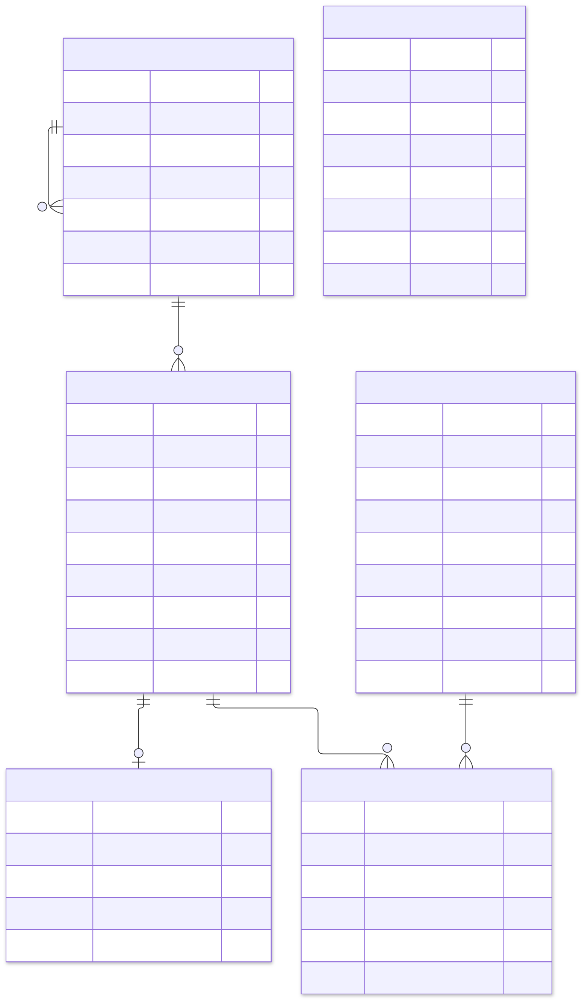
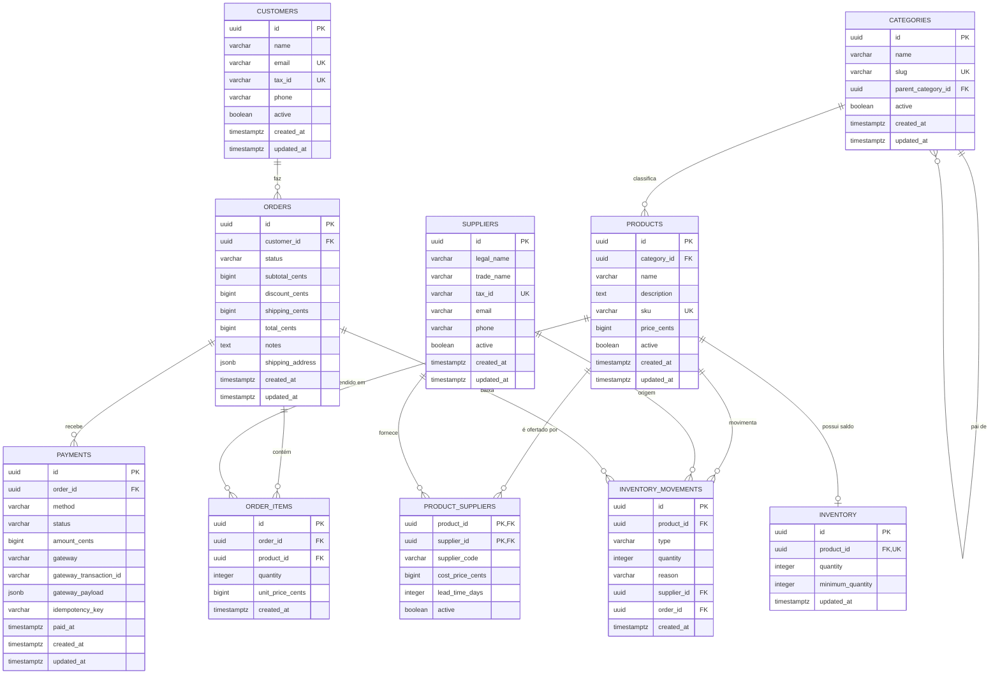

# Banco de dados — modelo inicial

Documento com o desenho das tabelas e das ligações do banco. O modelo cobre
catálogo (`products`, `categories`, `suppliers`, `inventory`), clientes
(`customers`), vendas (`orders`, `order_items`, `payments`) e o histórico de
estoque (`inventory_movements`).

Os nomes de tabelas e colunas seguem o padrão **inglês + `snake_case`**. A
prosa e os comentários continuam em português.

## Premissas do modelo

1. Um produto pertence a **uma categoria**; uma categoria pode ter vários
   produtos.
2. Uma categoria pode ter **subcategorias**, usando `parent_category_id`.
3. Um produto pode ter **vários fornecedores**, e um fornecedor pode fornecer
   vários produtos. Por isso existe a tabela de ligação `product_suppliers`.
4. O `inventory` representa o **saldo atual** de cada produto (relação 1:1). O
   histórico de entradas e saídas fica em `inventory_movements`.
5. Um cliente pode ter vários pedidos (`customers 1:N orders`). Cada pedido tem
   itens (`order_items`) e tentativas de pagamento (`payments`).
6. Valores monetários são armazenados em **centavos** (`bigint`), nunca em
   ponto flutuante.
7. Datas são armazenadas com timezone (`timestamptz`) e em UTC.
8. O preço do produto é copiado para `order_items.unit_price_cents` no momento
   da compra. O pedido guarda o total fechado, sem recalcular com preços atuais.

## Diagrama em imagem



Versão vetorial (melhor para zoom e impressão):
[diagrama-banco.svg](diagrama-banco.svg).

## 1. Diagrama ER



## 2. Visão textual das ligações

```
categories 1 ───────── N products 1 ─────── 0..1 inventory
     │                       │
     └── 1:N (subcategoria)  └── N:N ── product_suppliers ── N:1 suppliers

customers 1 ─── N orders 1 ─── N order_items N ─── 1 products
                     │
                     ├── 1:N payments
                     └── 1:N inventory_movements
```

## 3. Relacionamentos

| Origem | Destino | Cardinalidade | Chave estrangeira | Regra |
|---|---|---|---|---|
| `categories` | `products` | 1:N | `products.category_id` | Todo produto pertence a uma categoria. Categoria com produtos não deve ser excluída (`ON DELETE RESTRICT`). |
| `categories` | `categories` | 1:N (opcional) | `categories.parent_category_id` | Permite subcategorias. Ao excluir a categoria pai, as filhas podem ficar sem pai (`ON DELETE SET NULL`). |
| `products` | `inventory` | 1:0..1 | `inventory.product_id` (UNIQUE) | Cada produto tem no máximo um registro de saldo. Ao excluir o produto, o estoque é removido (`ON DELETE CASCADE`). |
| `products` | `product_suppliers` | 1:N | `product_suppliers.product_id` | Um produto pode ter vários fornecedores. |
| `suppliers` | `product_suppliers` | 1:N | `product_suppliers.supplier_id` | Um fornecedor pode fornecer vários produtos. |
| `customers` | `orders` | 1:N | `orders.customer_id` | Um cliente pode ter vários pedidos. Cliente com pedidos não deve ser excluído (`ON DELETE RESTRICT`). |
| `orders` | `order_items` | 1:N | `order_items.order_id` | Ao excluir o pedido, os itens são removidos (`ON DELETE CASCADE`). |
| `products` | `order_items` | 1:N | `order_items.product_id` | Produto com histórico de venda não deve ser excluído (`ON DELETE RESTRICT`). |
| `orders` | `payments` | 1:N | `payments.order_id` | Um pedido pode ter várias tentativas de pagamento. |
| `products` | `inventory_movements` | 1:N | `inventory_movements.product_id` | Histórico de entradas, saídas e ajustes do produto. |
| `suppliers` | `inventory_movements` | 1:N (opcional) | `inventory_movements.supplier_id` | Identifica a origem em entradas de compra. |
| `orders` | `inventory_movements` | 1:N (opcional) | `inventory_movements.order_id` | Identifica a baixa de estoque causada por uma venda. |

### Regras de integridade

- `products.category_id` é obrigatório e referencia `categories.id`.
- `product_suppliers` tem chave primária composta por
  (`product_id`, `supplier_id`) para impedir duplicidade.
- `inventory.product_id` é `UNIQUE`, garantindo a relação 1:1.
- `products.sku`, `categories.slug`, `suppliers.tax_id` e
  `customers.email`/`customers.tax_id` são `UNIQUE`.
- `quantity`, `minimum_quantity`, `price_cents` e `cost_price_cents` não podem
  ser negativos (`CHECK`).
- `order_items.quantity` deve ser maior que zero.
- `payments.amount_cents` deve ser maior que zero.
- No máximo um pagamento com status `paid` por pedido (índice parcial único).

## 4. Detalhamento das tabelas

### `categories`

| Coluna | Tipo | Observação |
|---|---|---|
| `id` | `uuid` | PK |
| `name` | `varchar(120)` | Obrigatório |
| `slug` | `varchar(140)` | Único, usado em URLs |
| `parent_category_id` | `uuid` | FK para `categories.id`, nullable |
| `active` | `boolean` | Padrão `true` |
| `created_at` / `updated_at` | `timestamptz` | Controle de auditoria |

### `suppliers`

| Coluna | Tipo | Observação |
|---|---|---|
| `id` | `uuid` | PK |
| `legal_name` | `varchar(200)` | Razão social, obrigatória |
| `trade_name` | `varchar(200)` | Nome fantasia, opcional |
| `tax_id` | `varchar(14)` | CNPJ, único |
| `email` | `varchar(255)` | Opcional |
| `phone` | `varchar(20)` | Opcional |
| `active` | `boolean` | Padrão `true` |
| `created_at` / `updated_at` | `timestamptz` | Controle de auditoria |

### `products`

| Coluna | Tipo | Observação |
|---|---|---|
| `id` | `uuid` | PK |
| `category_id` | `uuid` | FK obrigatória para `categories.id` |
| `name` | `varchar(120)` | Obrigatório |
| `description` | `text` | Opcional |
| `sku` | `varchar(64)` | Único |
| `price_cents` | `bigint` | Preço de venda, não negativo |
| `active` | `boolean` | Padrão `true` |
| `created_at` / `updated_at` | `timestamptz` | Controle de auditoria |

### `inventory`

| Coluna | Tipo | Observação |
|---|---|---|
| `id` | `uuid` | PK |
| `product_id` | `uuid` | FK única para `products.id` |
| `quantity` | `integer` | Saldo atual, não negativo |
| `minimum_quantity` | `integer` | Alerta de reposição |
| `updated_at` | `timestamptz` | Última atualização do saldo |

### `product_suppliers`

| Coluna | Tipo | Observação |
|---|---|---|
| `product_id` | `uuid` | PK e FK para `products.id` |
| `supplier_id` | `uuid` | PK e FK para `suppliers.id` |
| `supplier_code` | `varchar(64)` | Código do produto no fornecedor |
| `cost_price_cents` | `bigint` | Custo de compra, não negativo |
| `lead_time_days` | `integer` | Prazo médio de entrega em dias |
| `active` | `boolean` | Indica se a oferta ainda é válida |

### `customers`

| Coluna | Tipo | Observação |
|---|---|---|
| `id` | `uuid` | PK |
| `name` | `varchar(150)` | Obrigatório |
| `email` | `varchar(255)` | Único |
| `tax_id` | `varchar(14)` | CPF ou CNPJ, único |
| `phone` | `varchar(20)` | Opcional |
| `active` | `boolean` | Padrão `true` |
| `created_at` / `updated_at` | `timestamptz` | Controle de auditoria |

### `orders`

| Coluna | Tipo | Observação |
|---|---|---|
| `id` | `uuid` | PK |
| `customer_id` | `uuid` | FK obrigatória para `customers.id` |
| `status` | `varchar(30)` | Padrão `pending` |
| `subtotal_cents` | `bigint` | Soma dos itens, não negativo |
| `discount_cents` | `bigint` | Desconto aplicado, não negativo |
| `shipping_cents` | `bigint` | Frete, não negativo |
| `total_cents` | `bigint` | Total fechado do pedido |
| `notes` | `text` | Observação opcional |
| `shipping_address` | `jsonb` | Snapshot do endereço usado na compra |
| `created_at` / `updated_at` | `timestamptz` | Controle de auditoria |

Status sugeridos:

```
pending, paid, processing, shipped, delivered, cancelled
```

### `order_items`

| Coluna | Tipo | Observação |
|---|---|---|
| `id` | `uuid` | PK |
| `order_id` | `uuid` | FK obrigatória para `orders.id` |
| `product_id` | `uuid` | FK obrigatória para `products.id` |
| `quantity` | `integer` | Maior que zero |
| `unit_price_cents` | `bigint` | Preço do produto no momento da compra |
| `created_at` | `timestamptz` | Data de criação do item |

Restrição sugerida: `UNIQUE (order_id, product_id)` para não repetir o mesmo
produto no pedido. Remova se quiser permitir linhas duplicadas.

### `payments`

| Coluna | Tipo | Observação |
|---|---|---|
| `id` | `uuid` | PK |
| `order_id` | `uuid` | FK obrigatória para `orders.id` |
| `method` | `varchar(30)` | `pix`, `boleto`, `credit_card`, `debit_card`, `cash` |
| `status` | `varchar(30)` | Padrão `pending` |
| `amount_cents` | `bigint` | Valor da tentativa, maior que zero |
| `gateway` | `varchar(50)` | Nome do gateway, opcional |
| `gateway_transaction_id` | `varchar(255)` | ID da transação no gateway |
| `gateway_payload` | `jsonb` | Resposta bruta para auditoria |
| `idempotency_key` | `varchar(255)` | Evita cobrança duplicada |
| `paid_at` | `timestamptz` | Data de confirmação do pagamento |
| `created_at` / `updated_at` | `timestamptz` | Controle de auditoria |

Status sugeridos:

```
pending, authorized, paid, declined, refunded, cancelled
```

Regras:

- Nunca armazenar número de cartão, CVV ou validade; apenas token/ID do gateway.
- O webhook deve ser idempotente: `(gateway, gateway_transaction_id)` é único
  quando preenchido.
- Índice parcial único em `order_id` com `status = 'paid'` garante no máximo um
  pagamento aprovado por pedido. Remova se quiser permitir pagamento parcial.

## 5. Histórico de estoque

O registro de saldo em `inventory` responde “quanto tem agora”, mas não “o que
aconteceu”. Para auditoria e relatórios, use `inventory_movements`:

| Coluna | Tipo | Observação |
|---|---|---|
| `id` | `uuid` | PK |
| `product_id` | `uuid` | FK para `products.id` |
| `type` | `varchar(20)` | `in`, `out` ou `adjustment` |
| `quantity` | `integer` | Quantidade movimentada, positiva |
| `reason` | `varchar(255)` | Ex.: purchase, sale, loss, inventory_count |
| `supplier_id` | `uuid` | FK opcional, usada em entradas |
| `order_id` | `uuid` | FK opcional, usada em saídas por venda |
| `created_at` | `timestamptz` | Data da movimentação |

Relação: `products 1:N inventory_movements`. O saldo em `inventory` passa a ser
atualizado junto com cada movimentação, dentro da mesma transação.

## 6. Índices recomendados

| Tabela | Índice | Motivo |
|---|---|---|
| `products` | `(category_id)` | Listar produtos por categoria |
| `products` | `(sku)` único | Busca e integridade |
| `categories` | `(slug)` único | Busca por URL |
| `categories` | `(parent_category_id)` | Montar árvore de categorias |
| `inventory` | `(product_id)` único | Garantir 1:1 e busca rápida |
| `product_suppliers` | `(supplier_id)` | Listar produtos de um fornecedor |
| `suppliers` | `(tax_id)` único | Integridade |
| `customers` | `(email)` único | Login/busca |
| `customers` | `(tax_id)` único | Integridade |
| `orders` | `(customer_id)` | Listar pedidos do cliente |
| `orders` | `(status)` | Filtrar pedidos por status |
| `orders` | `(created_at)` | Relatórios por período |
| `order_items` | `(order_id)` | Carregar itens do pedido |
| `order_items` | `(product_id)` | Histórico de vendas do produto |
| `payments` | `(order_id)` | Listar pagamentos do pedido |
| `payments` | `(status)` | Filtrar por status |
| `payments` | `(gateway, gateway_transaction_id)` único parcial | Idempotência do webhook |
| `payments` | `(order_id)` único parcial com `status = 'paid'` | Um pagamento aprovado por pedido |
| `inventory_movements` | `(product_id, created_at)` | Histórico do produto |
| `inventory_movements` | `(order_id)` | Rastrear baixa por venda |

## 7. Alternativas de modelagem

- **Um fornecedor por produto (MVP):** trocar a tabela `product_suppliers` por
  uma coluna `supplier_id` em `products`. Fica mais simples, mas impede comparar
  preços e prazos de vários fornecedores.
- **Produto em várias categorias:** trocar `products.category_id` por uma
  tabela `product_categories` (N:N). Útil se o mesmo produto aparece em mais de
  uma categoria.
- **Estoque por depósito:** criar `warehouses` e fazer
  `inventory (product_id, warehouse_id)` com chave composta, em vez de 1:1 por
  produto.
- **Endereço completo:** trocar `orders.shipping_address` (`jsonb`) por uma
  tabela `addresses` com `customer_id` e/ou `order_id`. O `jsonb` é mais simples
  e preserva o endereço exato da compra.
- **Exclusão lógica:** usar `active`/`deleted_at` em vez de `DELETE` físico para
  preservar histórico de pedidos.

## 8. Ordem das migrations

As tabelas têm dependências entre si. Crie nesta ordem:

```
000001_create_categories
000002_create_suppliers
000003_create_products
000004_create_inventory
000005_create_product_suppliers
000006_create_customers
000007_create_orders
000008_create_order_items
000009_create_payments
000010_create_inventory_movements
```

`inventory_movements` só pode ser criada depois de `orders`, porque tem
`order_id`. `payments` depende de `orders`.
